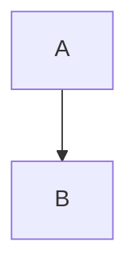

# mdx-blog 文章區塊元件

`apps/mdx-blog` 用 `next-mdx-remote-client` 渲染文章，文章正文本身就是一段 **MDX 字串**（存在資料庫 `post.content` 欄位裡，沒有 YAML frontmatter — 標題/摘要/封面/標籤/分類另有獨立欄位，見 [post.ts](../../../apps/mdx-blog/src/schemas/post.ts)）。

寫文章內容時只需輸出 MDX 正文本身（markdown + 下列 JSX 標籤），不要加 `---` frontmatter 區塊。

## 核心規則

區塊元件一律用 **JSX 標籤**書寫（`<Alert>...</Alert>`），**不要**用：
- ` ```fence ` 圍欄（除了 `mermaid` / `echarts`，見下方例外）
- `<!-- -->` HTML 註解（會被 MDX 剝除）
- Hexo 的 `` 語法（此專案沒有對應的 remark plugin）

標籤內可以直接放任意巢狀 markdown（粗體、清單、圖片、程式碼區塊…），不需要跳脫。

元件註冊於 [index.tsx](../../../apps/mdx-blog/src/components/mdx/index.tsx)，實作在 [renderers/](../../../apps/mdx-blog/src/components/mdx/renderers/)。

## 元件清單

### Alert（提示框）

```mdx
<Alert type="warning" title="注意">
這裡支援**任意 markdown**內容。
</Alert>
```

- `type`: `note`(預設) / `info` / `success` / `warning` / `danger`
- `title`: 選填，省略則只顯示內文

### Accordion / AccordionItem（折疊面板）

```mdx
<Accordion>
  <AccordionItem title="問題一" open>
  答案內容，支援 **markdown**。
  </AccordionItem>
  <AccordionItem title="問題二">
  另一段答案。
  </AccordionItem>
</Accordion>
```

- `Accordion.multiple`: 是否允許同時展開多項，預設 `false`（單選）
- `AccordionItem.title`: 必填，折疊標題
- `AccordionItem.open`: 選填，預設是否展開

### Tabs / Tab（分頁）

```mdx
<Tabs defaultIndex={0}>
  <Tab label="JavaScript">
  ```js
  console.log('hi')
  ```
  </Tab>
  <Tab label="Python">
  ```python
  print('hi')
  ```
  </Tab>
</Tabs>
```

- `Tabs.defaultIndex`: 預設選中分頁（從 0 起算），預設 `0`
- `Tab.label`: 必填，分頁標籤文字（Tab 之間用 `label` prop 辨識，不是靠元件型別）

### Carousel / Slide（輪播）

```mdx
<Carousel>
  <Slide></Slide>
  <Slide></Slide>
</Carousel>
```

- `Carousel.loop`: 是否循環播放，預設 `true`
- `Slide` 內可放圖片或任意 markdown

### Progress（進度條）

常用於技能熟練度列表。

```mdx
<Progress value={90} label="HTML" color="amber" />
<Progress value={70} label="TypeScript" color="blue" />
```

- `value`: 必填，0–100
- `label`: 選填，左側標籤文字
- `color`: `blue`(預設) / `green` / `amber` / `red` / `purple` / `pink`
- `showValue`: 是否顯示百分比數字，預設 `true`

### Benchmark / BenchmarkItem（效能比較長條圖）

常用於優化前後、多方案速度對比（例如打包工具耗時、優化前後的載入時間）。各長條寬度依「所有項目中的最大值」等比例縮放，不是各自獨立的 0–100%；數值最佳的項目會自動標示閃電圖示。

```mdx
<Benchmark unit="ms">
  <BenchmarkItem label="優化前" value={4200} />
  <BenchmarkItem label="優化後" value={180} />
</Benchmark>
```

多方案對比，且數值越大越好（例如吞吐量）：

```mdx
<Benchmark unit=" req/s" lowerIsBetter={false}>
  <BenchmarkItem label="方案 A" value={1200} />
  <BenchmarkItem label="方案 B" value={3400} />
  <BenchmarkItem label="方案 C" value={2100} />
</Benchmark>
```

- `Benchmark.lowerIsBetter`: 數值越小越好，預設 `true`（例如耗時）；設為 `false` 時數值越大越好（例如吞吐量）
- `Benchmark.unit`: 套用到所有項目的預設單位字串（例如 `"ms"`），`BenchmarkItem` 可用自己的 `unit` 覆寫
- `BenchmarkItem.label`: 選填，左側標籤文字
- `BenchmarkItem.value`: 必填，數字（不是百分比，例如 `4200` 代表 4200ms）
- `BenchmarkItem.unit`: 選填，覆寫該項目的單位
- `BenchmarkItem.color`: 選填，`blue` / `green` / `amber` / `red` / `purple` / `pink`，未設定時由最佳結果自動判斷（最佳為綠色，其餘為藍色）
- `BenchmarkItem.highlight`: 選填，手動標記最佳結果；只要任一 item 設定此 prop，整組就改用手動模式（不再依數值自動判斷）

### CustomQuote（自訂引言）

```mdx
<CustomQuote author="某某人" variant="info">
這是一段引言內容。
</CustomQuote>
```

- `author`: 選填，顯示在引言下方
- `variant`: `default`(預設) / `warning` / `info` / `success`

### Count（互動計數器 demo 元件）

```mdx
<Count />
```

無 props，純示範用的 client 互動元件（點擊按鈕累加數字）。一般文章很少需要用到。

### Playground（可執行的程式碼示範，僅 tan-blog）

文章本體**永遠不執行程式**（不能 `export` 元件、不能寫 `{表達式}`）。需要「跑起來看」的示範，把程式碼當**資料**放進 `<Playground>`，它會在隔離的 `sandbox="allow-scripts"` iframe 中執行（碰不到部落格的 DOM / cookie）。

````mdx
<Playground template="react" title="計數器">
```jsx App.jsx
import { useState } from 'react'
import Button from './Button'

export default function App() {
  const [count, setCount] = useState(0)
  return <Button onClick={() => setCount(count + 1)}>點了 {count} 次</Button>
}
```

```jsx Button.jsx
export default function Button(props) {
  return <button {...props} />
}
```

```css styles.css hidden
button { padding: 8px 16px; }
```
</Playground>
````

````mdx
<Playground template="vanilla" height={160} autoRun>
```html
<p id="out"></p>
```

```js
document.getElementById('out').textContent = new Date().toISOString()
console.log('hi')
```
</Playground>
````

- `template`: 必填，`react` / `html` / `vanilla`
  - `react`：入口是 `App.jsx`（`export default` 一個元件），可 `import` 其他檔案（`./Button`）與 npm 套件（經 esm.sh，React 固定 18.3.1）
  - `html` / `vanilla`：html、css、js 組成單一頁面；js 以 ES module 執行，同樣可 import npm 套件
- `title`: 選填，標題列文字
- `height`: 選填，預覽區高度 px（80–1200，預設 320）
- `autoRun`: 選填，進入畫面自動執行；預設需讀者按「執行」
- **子元素只能是 code fence**，語言限 `html` / `css` / `js` / `jsx`（不支援 TypeScript）
- fence meta 第一個字是檔名（例如 ` ```jsx App.jsx `），省略時依語言預設 `index.html` / `styles.css` / `index.js` / `App.jsx`；檔名不可重複
- meta 加上 `hidden`：不顯示分頁，但仍參與執行（適合樣式等樣板）
- 不要直接寫 `<PlaygroundFile>`（那是編譯器產生的內部節點）
- `console.log` / 錯誤會顯示在預覽下方的 Console

### Excalidraw（手繪風圖表）

```mdx
<Excalidraw src="https://cdn.example.com/diagrams/flow.excalidraw" caption="請求流程" />
```

- `src`: 必填，excalidraw.com 分享連結（`https://excalidraw.com/#json=ID,KEY`，後台編輯器直接貼上連結會自動轉成此元件），或 `.excalidraw`（JSON）檔的完整網址；瀏覽器端轉成 SVG，進入畫面才載入
- `caption`: 選填，圖說，同時作為無障礙替代文字（會被翻譯）
- 底色透明、深色模式自動反相，畫圖時用淺色背景即可
- 結構化的流程圖／時序圖優先用 `mermaid`；需要自由排版、註解或手繪質感時才用 Excalidraw

## 例外：mermaid / echarts 仍用 fence

因為內容本身是程式碼/資料，這兩個**不要**改成 JSX 標籤：

````mdx

````

````mdx
```echarts
{ "title": { "text": "範例圖表" }, "xAxis": {}, "yAxis": {}, "series": [] }
```
````

`echarts` 圍欄內必須是合法 JSON（會被 `JSON.parse`），不是 JS 物件字面量。

## 其他自動處理（不需手動加標籤）

- 一般 markdown 圖片 `` 會自動用 `next/image` 渲染，不需另外包裝。
- 外部連結（`http(s)://` 開頭的 `[text](url)`）會自動套用增強樣式，站內連結維持原生 `<a>`。
- 標題（`#` ~ `######`）會自動加上 `scroll-mt-20`，不需手動處理。

## 常見錯誤

- **元件沒有渲染，直接印出標籤文字**：通常是把子元件（`AccordionItem`/`Tab`/`Slide`/`BenchmarkItem`）放在容器外，或忘記容器包起來。
- **Accordion/Tabs/Benchmark 內容消失**：`AccordionItem` 需要 `title`、`Tab` 需要 `label`、`BenchmarkItem` 需要 `value`，缺少必填 prop 會被過濾掉（`isAccordionItem`/`isTab`/`isBenchmarkItem` 判斷失敗）。
- **echarts 圖表顯示「JSON 格式錯誤」**：圍欄內容不是合法 JSON（例如用了單引號或尾逗號）。
