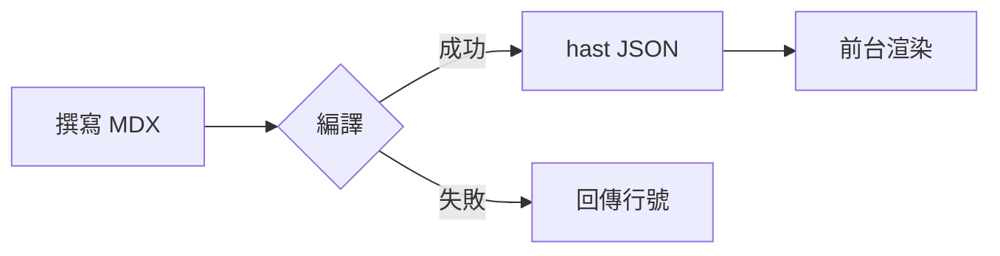

{/*
  元件設計測試（kitchen sink）
  ─────────────────────────────
  把文章裡會出現的每一種區塊、每一種變體都放一次，改元件或樣式（blocks.css、DESIGN.md）時拿來一頁看完。
  後台有一篇同內容的草稿「元件設計測試」：打開編輯器，右側預覽走的就是正式頁面的編譯管線。
  新增元件或變體時，請在這裡補一段示範，並同步更新那篇草稿。
  檢查清單：晝／夜讀、四季（頁尾可預覽）、手機寬度、鍵盤操作（Tab／Enter／方向鍵）。
*/}

這篇文章不是給讀者看的，是給元件看的：每一種區塊都在這裡出現一次，改樣式時一頁看完晝、夜讀與手機寬度。

## 文字與行內元素

一般段落裡會有**粗體**、*斜體*（中文不建議用）、~~刪除線~~、行內程式碼 `useEffect` 與 `pnpm run dev`、
外部連結 [TanStack Start](https://tanstack.com/start/latest)、[GitHub 連結](https://github.com/sao-coding)，
還有站內連結 [回到文章列表](/posts)。註腳也要能用[^1]，同一個註腳可以引用兩次[^1]，再來一個[^long]。

按 <Kbd>Ctrl</Kbd>+<Kbd>K</Kbd> 開啟搜尋（小寫 <kbd>Esc</kbd> 也是同樣樣式）。
日文的<Ruby rt="かんじ">漢字</Ruby>可以標振假名，冷僻字也能標注音：<Ruby rt="ㄒㄧㄣ">馨</Ruby>。
這句話後面有一則旁註<Sidenote>桌機顯示在段落右側；手機點編號才展開。</Sidenote>，
再來一則<Sidenote>旁註整篇連號，支援 **markdown** 與 `code`。</Sidenote>看編號有沒有接著算。

用螢光筆<Mark>畫重點</Mark>，用朱筆<Mark type="underline">劃底線</Mark>、<Mark type="strike">刪掉這句</Mark>、
把<Mark type="circle">關鍵字</Mark>圈起來或<Mark type="box">框起來</Mark>；也能<Mark color="pink">換顏色</Mark>、<Mark type="underline" color="blue">換筆色</Mark>。
跨行也可以：<Mark>這是一段比較長、在窄螢幕上會折成兩行以上的螢光筆標記，每一行都會各自畫上一筆，不會只畫在第一行</Mark>。

[^1]: 這是一個註腳，文末的返回圖示會帶你回到引用的地方。
[^long]: 第二個註腳，內容可以比較長，也能放 **markdown** 與 `code`。

### 清單

- 無序清單第一項
- 第二項，裡面有 `code`
  - 巢狀項目
- 第三項

1. 有序清單
2. 第二步
3. 第三步

- [x] 已完成的待辦
- [ ] 還沒做的待辦

### 表格

| 元件 | 用途 | 狀態 |
| --- | --- | :---: |
| `Alert` | 提示、警告 | ✅ |
| `Tabs` | 多語言程式碼切換 | ✅ |
| `Benchmark` | 效能比較 | ✅ |

### 數學

行內公式 $E = mc^2$，區塊公式：

$$
\sum_{i=1}^{n} i = \frac{n(n+1)}{2}
$$

---

## 程式碼

單行指令（不顯示行號）：

```bash
pnpm --filter tan-blog dev
```

高亮行 `{2,4-5}`，第 4 行很長（測試自動換行與橫向捲動）：

```ts {2,4-5}
import { createServerFn } from '@tanstack/react-start'
const greet = createServerFn({ method: 'GET' })
  .handler(async () => {
    const message = 'hello from the server, this line is intentionally rather long so we can test wrapping behaviour on narrow screens'
    return { message }
  })
```

超過 15 行（預設收合、底部淡出、展開／收合後捲回區塊開頭）：

```python
def fib(n):
    a, b = 0, 1
    for _ in range(n):
        a, b = b, a + b
    return a


def main():
    for i in range(10):
        print(i, fib(i))


if __name__ == "__main__":
    main()

# 下面多寫幾行讓它超過 15 行
x = 1
y = 2
z = x + y
print(z)
```

各語言圖示：

```tsx
export const Hello = () => <p>Hello</p>
```

```json
{ "name": "sao-blog", "private": true }
```

```rust
fn main() { println!("hello"); }
```

```go
package main
```

```dockerfile
FROM node:22-alpine
```

```powershell
Get-ChildItem -Recurse
```

```caddyfile
example.com { reverse_proxy localhost:3000 }
```

```
沒有標記語言的程式碼（顯示「純文字」）
```

檔名標題 `title="..."`：

```ts title="vite.config.ts"
import { defineConfig } from 'vite'

export default defineConfig({ server: { port: 3004 } })
```

差異標記 `// [!code ++]`、`// [!code --]`（複製時不含刪除行）：

```ts title="server.ts"
const app = new Elysia()
  .use(cors()) // [!code --]
  .use(cors({ origin: 'https://sao.blog' })) // [!code ++]
  .listen(3000)
```

聚焦 `// [!code focus]`（其餘行淡掉，滑過恢復）與 `// [!code highlight]`：

```ts
export async function loader() {
  const post = await getPost() // [!code focus]
  if (!post) throw notFound() // [!code highlight]
  return post
}
```

## 提示

<Alert type="note">沒有標題時顯示類型名稱。</Alert>

<Alert type="info" title="小提醒">這裡可以寫 **markdown**，也可以放 `code` 與[連結](/posts)。</Alert>

<Alert type="success">建置完成。</Alert>

<Alert type="warning" title="注意">
這個 API 在下一版會移除。

內文可以有好幾段，也可以放清單：

- 第一點
- 第二點
</Alert>

<Alert type="danger">不要在正式環境執行 `rm -rf /`。</Alert>

## 引言

<Quote author="魯迅">其實地上本沒有路，走的人多了，也便成了路。</Quote>

<Quote variant="info">沒有署名、info 語意色的引言。</Quote>

<Quote variant="warning">warning 語意色的引言。</Quote>

<Quote variant="success">success 語意色的引言。</Quote>

> 一般的 markdown 引言，不用斜體。
>
> 第二段。

## 折疊

<Accordion>
  <AccordionItem title="為什麼要遵循設計原則？" open>
  一致的規則讓每個新元件都「長得像這個站」，不用每次重新決定顏色和邊框。
  </AccordionItem>
  <AccordionItem title="收起的內容找得到嗎？">
  找得到：收起的內容用 `hidden="until-found"` 留在頁面裡，用瀏覽器的頁內搜尋找這段文字會自動展開。
  </AccordionItem>
  <AccordionItem title="可以放程式碼嗎？">
  ```js
  console.log('accordion')
  ```
  </AccordionItem>
</Accordion>

可同時展開多項：

<Accordion multiple>
  <AccordionItem title="第一項" open>第一項內容</AccordionItem>
  <AccordionItem title="第二項" open>第二項內容</AccordionItem>
</Accordion>

問答模式 `variant="faq"`：

<Accordion variant="faq">
  <AccordionItem title="文章可以轉載嗎？" open>
  可以，註明出處並附上原文連結即可。
  </AccordionItem>
  <AccordionItem title="怎麼訂閱新文章？">用 RSS：網址是 `/rss.xml`。</AccordionItem>
  <AccordionItem title="留言會被審核嗎？">第一次留言會，之後就不用了。</AccordionItem>
</Accordion>

## 分頁

只放一段程式碼時，程式碼貼齊外框、工具浮在右上角：

<Tabs>
  <Tab label="JavaScript">
  ```js
  console.log('hi')
  ```
  </Tab>
  <Tab label="Python">
  ```python
  print('hi')
  ```
  </Tab>
  <Tab label="說明">
  分頁裡放一般文字時，會有內距和紙色底。
  </Tab>
</Tabs>

預設選第二個分頁、分頁很多（窄螢幕橫向捲動）：

<Tabs defaultIndex={1}>
  <Tab label="npm">npm install sao-blog</Tab>
  <Tab label="pnpm">pnpm add sao-blog</Tab>
  <Tab label="yarn">yarn add sao-blog</Tab>
  <Tab label="bun">bun add sao-blog</Tab>
  <Tab label="deno">deno add npm:sao-blog</Tab>
</Tabs>

## 圖片

預設外框（髮絲線＋柔影），alt 當圖說並自動編號：


截圖襯底：


拍立得（直式照片）：


裝飾圖（alt 以 `_` 開頭，不顯示圖說）：


## 輪播

<Carousel>
  <Slide></Slide>
  <Slide></Slide>
  <Slide>
  第三張是文字，輪播裡也可以放任意 markdown。
  </Slide>
</Carousel>

## 圖表



## 進度條

<Progress value={90} label="HTML" color="amber" />
<Progress value={70} label="TypeScript" color="blue" />
<Progress value={60} label="Go" color="green" />
<Progress value={50} label="Elixir" color="purple" />
<Progress value={40} label="CSS" color="pink" />
<Progress value={30} label="C" color="red" />
<Progress value={55} label="沒指定顏色（朱）" />
<Progress value={80} label="不顯示數值" showValue={false} />

## 效能比較

越低越好（自動找出最佳、其餘標倍數）：

<Benchmark unit="ms">
  <BenchmarkItem label="Webpack" value={4200} />
  <BenchmarkItem label="esbuild" value={180} />
  <BenchmarkItem label="Vite" value={620} />
</Benchmark>

越高越好、手動標記：

<Benchmark lowerIsBetter={false} unit="req/s">
  <BenchmarkItem label="Express" value={15000} />
  <BenchmarkItem label="Elysia" value={255000} highlight />
  <BenchmarkItem label="Hono" value={190000} color="blue" />
</Benchmark>

## Playground

<Playground template="html" title="按鈕示範" height={160}>
```html index.html
<button id="b">Click</button>
```
```css style.css
button { font: inherit; padding: .5rem 1rem; }
```
```js main.js
document.getElementById('b').onclick = () => {
  console.log('clicked')
  console.warn('warn')
  console.error('error')
}
```
</Playground>

<Playground template="react" title="React 計數器" height={140}>
```jsx App.jsx
import { useState } from 'react'

export default function App() {
  const [n, setN] = useState(0)
  return <button onClick={() => setN(n + 1)}>clicked {n} times</button>
}
```
</Playground>

## 步驟

<Steps>
  <Step title="安裝 Docker">
  ```bash
  curl -fsSL https://get.docker.com | sh
  ```
  </Step>
  <Step title="寫好 compose 檔">
  建一個 `compose.yaml`，內容支援任意 **markdown**。
  </Step>
  <Step title="啟動服務">執行 `docker compose up -d`，打開 <Kbd>http://localhost:3000</Kbd>。</Step>
</Steps>

## 檔案樹

<FileTree>
- apps/
  - tan-blog/
    - src/
      - components/
        - mdx/
          - **blocks.css** 文章區塊的共用樣式
          - DESIGN.md 設計原則
          - renderers/
            - …
      - styles.css
    - vite.config.ts 建置設定
- packages/
  - mdx/
- package.json
- README.md
</FileTree>

## 連結卡片

<LinkCard href="https://tanstack.com/start/latest" />

<LinkCard href="https://bun.sh" />

github.com/owner/repo 會自動變成 GitHub 卡片（星星、語言、過去一年的 commit）：

<LinkCard href="https://github.com/TanStack/router" />

<LinkCard href="https://example.com/no-preview" title="手動指定標題" description="抓不到預覽時用 title / description 補上。" />

## 終端機

靜態（預設）：指令前有提示字元，複製只會複製指令。

<Terminal title="zsh">
```bash
# 安裝相依套件
$ pnpm install
Lockfile is up to date, resolution step is skipped
Packages: +1287
Done in 4.2s
$ pnpm --filter tan-blog dev
  VITE v8.3.4  ready in 1830 ms
  ➜  Local:   http://localhost:3004/
```
</Terminal>

`animate`：捲到才逐行打出來，點一下跳到結尾。

<Terminal title="PowerShell" animate>
```powershell
PS C:\code> git status
On branch main
nothing to commit, working tree clean
PS C:\code> git log --oneline -1
ace150b feat(tan-blog): Mark 手繪標記
```
</Terminal>

## 推文

<Tweet id="20" />

網址也會自動變成推文卡片（含影片封面）：

<LinkCard href="https://x.com/elonmusk/status/1585341984679469056" />

## 便條紙

捲到這裡時，這個<Mark>螢光筆標記</Mark>和<Mark type="circle">圈圈</Mark>才會畫上去。

<StickyNote title="給未來的自己">
記得每年換一次備份硬碟，**不要等到它壞掉**。
</StickyNote>

<StickyNote color="pink">粉色便條，沒有標題。</StickyNote>

<StickyNote color="blue">藍色便條，裡面也能放 `code`。</StickyNote>

<StickyNote color="green">綠色便條。</StickyNote>

## 前後對比

<ImageCompare
  before="https://picsum.photos/id/1015/1200/675?grayscale"
  after="https://picsum.photos/id/1015/1200/675"
  beforeLabel="黑白"
  afterLabel="彩色"
  alt="拖動分隔線比較黑白與彩色"
/>

## 影片

<Embed src="https://www.youtube.com/watch?v=jNQXAC9IVRw" title="YouTube：點了才載入播放器" />

<Embed src="https://www.bilibili.com/video/BV1GJ411x7h7" title="Bilibili（沒有縮圖，顯示紙色底）" />

